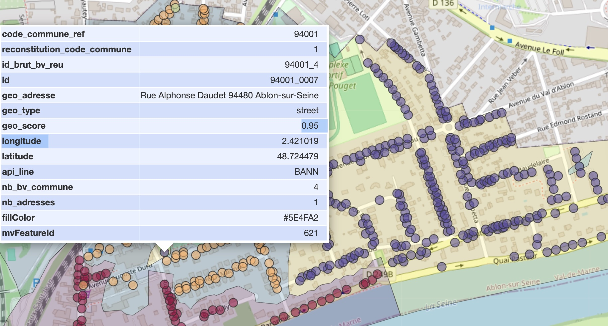
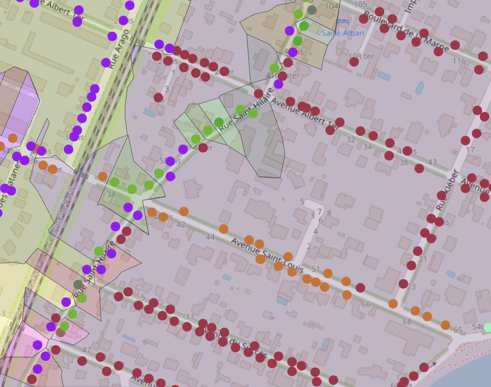
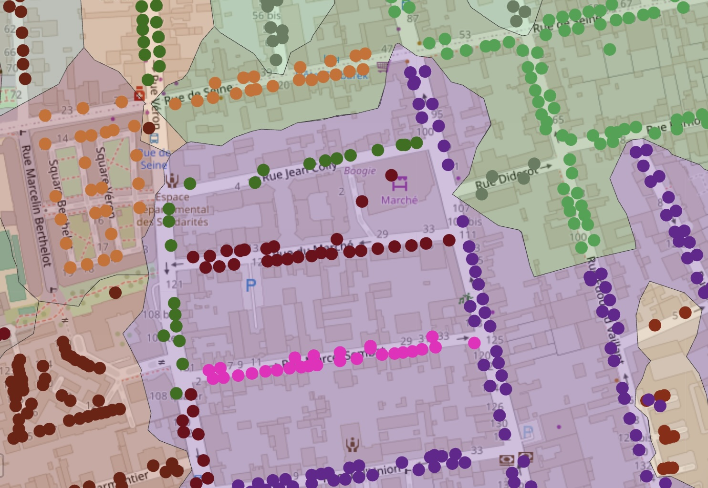
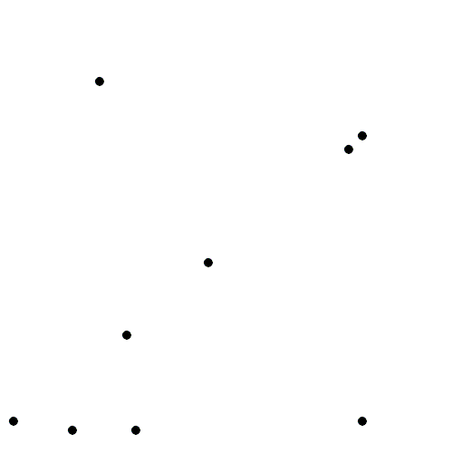
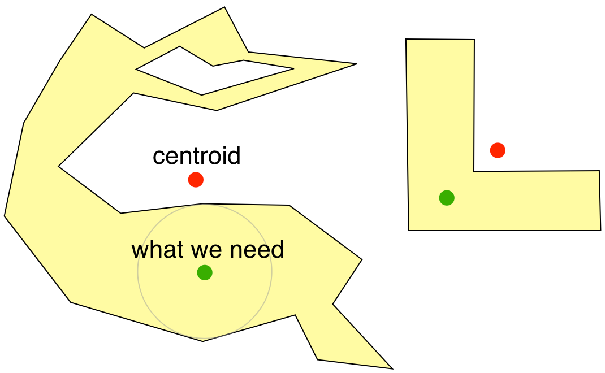
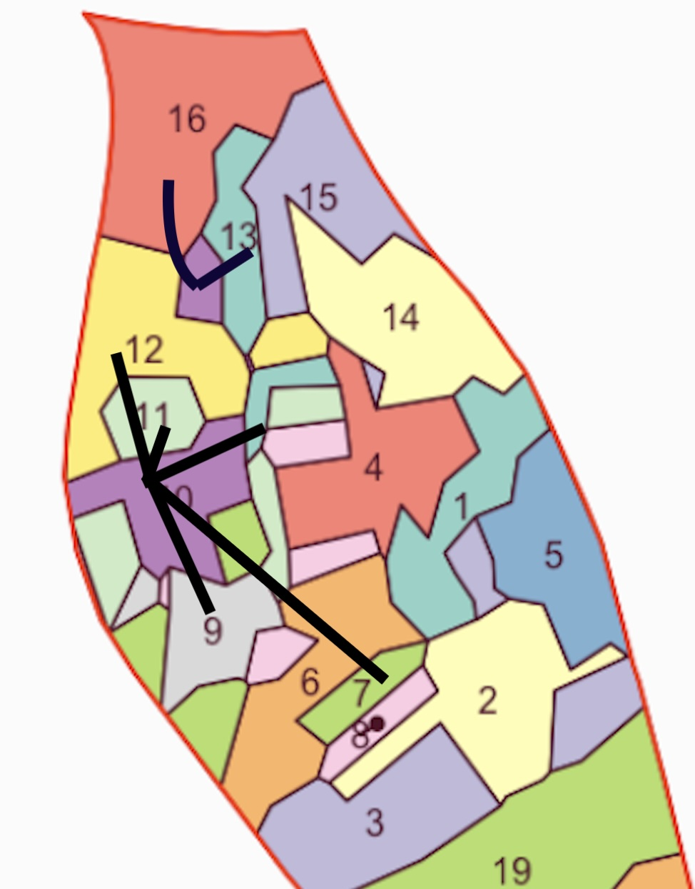
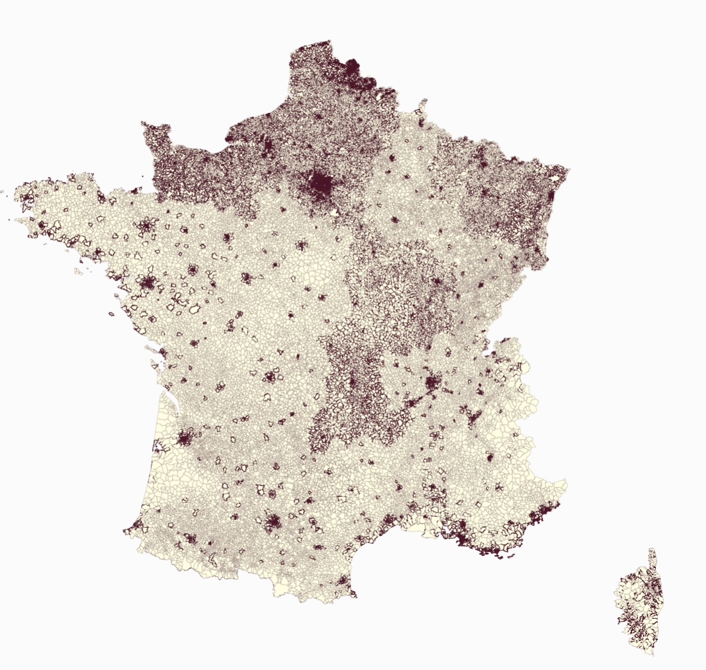
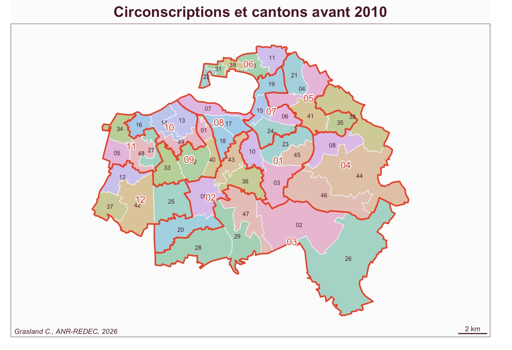
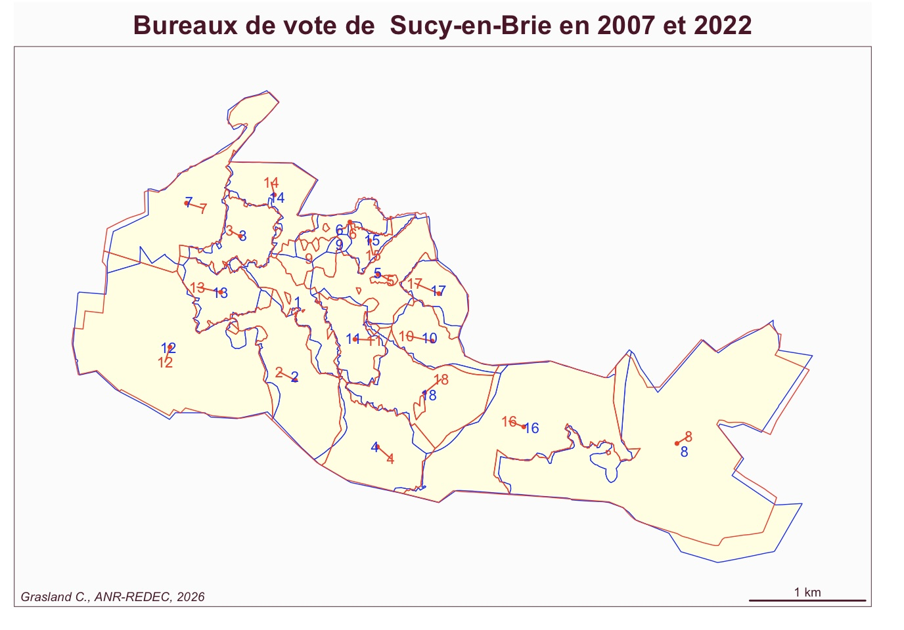
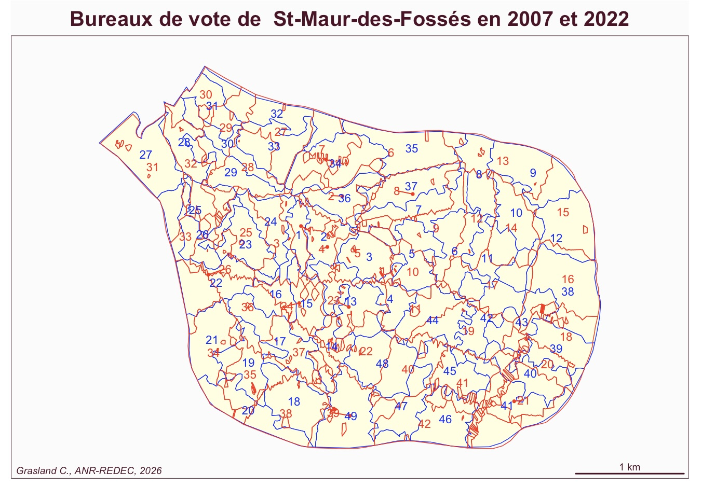

```{r, echo=FALSE, }
library(sf)
library(mapsf)
library(dplyr)
library(leaflet)
library(ggplot2)
library(data.table)
library(rmapshaper)
library(RColorBrewer)
library(mapview)
mypal<-brewer.pal(name = "Set3",n = 12)
mypal<-rep(mypal,10)
```


# INTRODUCTION

## Equipe

### UMR Géographie-cités
- Claude Grasland, PR, Département de géographie, UPC

### Plateforme GEOTECA
- Véronique Michot, MCF, Département de géographie, UPC
- Paul Passy, MCF, Département de géographie, UPC
- Brian Plaisant, Ingénieur, UPC

### Etudiants de master
- Waël Watanabe, Master 2 Géoprisme, UPC
- X***, Master 2 Carthageo, UPC ou UP1 ou ENSG

## Objectifs du WP. E

-  **Tâche E.1.a** : Reconstitution des géométries électorales de 2022

- **Tâche E.1.b** : enrichissements socio-démographique et accessibilité

- **Tâche E.2** : outil de visualisation 

- **Tâche E.3** : études de cas 

- **Tache E.4 (?)** : Reconstitution des géométries électorales de 2007-2010 à l'aide de la base CARTELEC


## Focus sur la tâche E.1

Le but de la tâche E.1 est de reconstruire la géométrie de l'ensemble des maillages politiques (communes, cantons, circonscriptions, départements) à partir de la brique de base constituée par les bureaux de votes. Plusieurs difficultés doivent être résolus :

## Difficultés

1. **Choix de la date de référence** : la carte des bureaux de vote est en évolution constante et peut changer d'une élection à une autre, généralement par ajout de nouveaux bureaux de vote. En première analyse, on prendra comme référence les élections présidentielles et législatives de 2022. 

2. **Incertitudes sur la géométrie des bureaux de vote** : il n'existe pas de cartographie précise des contours des bureaux de vote mais une simple liste de rues, sections de trottoirs rattachées à tel ou tel bureau de vote. L'INSEE a proposé une première cartographie des bureaux de vote à partir du fichier des adresses des votants mais ces géométries semblent comporter beaucoup d'erreurs ou d'irrégularités.

3. **Simplification des limites** : On souhaite disposer d'un fichier simplifié des contours des bureaux de vote afin de pouvoir plus facilement en déduire leur topologie et effectuer des transformations de type cartogramme (modification des surfaces pour les rendre proportionnelles au nombre d'inscrit). Mais cette simplification doit être aussi juste que possible et ne pas altérer les limites connues avec certitude.

# SOURCES

## La carte des bureaux de vote en 2022

L'INSEE a établi pour la première fois en 2022 une cartographie complète des bureaux de vote en France en se servant du répertoire électoral unique (REU) et de la base des adresses nationales (BAN). La méthodologie rigoureuse est présentée en détail dans le billet de blog publié le 28 juin 2023 et intitulé [« A voté » : à chaque bureau de vote ses électeurs](https://blog.insee.fr/a-vote-a-chaque-bureau-de-vote-ses-electeurs/). 

Ce découpage est a priori en adéquation avec notre objectif puisqu'il est fondé sur la situation des fichiers électoraux en **septembre 2022**, soit juste après les élections législatives et présidentielles qui ont eu lieu cette année-là.

## Le package mapvotR et le REU

Il est toutefois possible de refaire les analyses à la même date ou à une date ultérieure puisque l'INSEE a également mis à disposition l'ensemble des programmes permettant d'établir le découpage en bureaux de vote sous la forme d'un package R appelé [mapvotR](https://inseefrlab.github.io/mapvotr/articles/mapvotr.html)

On peut accèder au répertoire électoral unique ou [REU](https://www.data.gouv.fr/datasets/bureaux-de-vote-et-adresses-de-leurs-electeurs) qui donne la position géographique des électeurs déduite de leur adresse.

## Agrégation des BV par circonscription

Les résultats détaillés des élections présidentielles ou légslatives de 2022 par bureau de vote peuvent être utilisés pour établir la table de correspondance avec les bureaux de vote et ainsi donner la clé d'agrégation des géométries. La source est accessible sans difficultés sur le site [data.gouv.fr](https://www.data.gouv.fr/datasets/election-presidentielle-des-10-et-24-avril-2022-resultats-definitifs-du-1er-tour)

## Agrégation des BV par cantons

Les dernières éléctions cantonales de 2021 utilisent des bureaux de votes qui ne coïncident pas forcément avec ceux de 2022. On devra donc utiliser une méthode plus approximative (intersection géographique) pour les reconstituer approximativement dans le découpage de 2022.

## Votes depuis 1999

Un fichier a première vue extraordinaire vient d'être récemment publié qui donne les résultats par bureau de vote pour toutes les élections en France depuis 1999. Les numéros des bureaux de vote ne correspondent évidemment pas toujours d'une élection à l'autre, mais c'est tout de même une source assez fabuleuse à explorer : [Données des élections agrégées](https://www.data.gouv.fr/datasets/donnees-des-elections-agregees?tab=data-structure)

## Les bureaux de vote en 2007-2010

Il est possible de disposer d'une carte des bureaux de vote vers 2007-2010 grâce aux archives de l'ANR CARTELEC qui ne sont plus disponibles directement sur le web mais dont on dispose d'une copie. Cette source comprend :

- une cartographie de la géométrie des BV vers 2007
- les résultats des élections présidentielles de 2007
- les résultats des élections européennes de 2009
- les résultats des élections législatives de 2010
- des variables socio-économiques déduites du RP 2007

# EXPERIENCE 1 :  Généralisation du tracé de la carte des bureaux de vote en 2022

## Problème


```{r}
bv <- readRDS("map/bv94/mapbv.RDS") %>% st_transform(2154)
com<-bv %>% group_by(comcode, comname) %>% summarise()
#plot(com$geometry)
```

Comment simplifier les contours des bureaux de vote d'une commune sans modifier les frontières externes de celle-ci ? Le problème n'est pas évident comme on va le voir et plusieurs solutions sont possibles...Prenons d'abord un cas simple avec l'exemple d'Ablon

```{r}

mycom<-94001
myname<-"Ablon"

selbv <- bv %>% filter(comcode==mycom) %>% 
            select(comcode, bvonum) %>%
            arrange(bvonum) %>%
            mutate(bvorder = 1:length(bvonum))


selcom <- com %>% filter(comcode==mycom) %>% select(comcode)

mf_map(selbv, type="typo", var="bvonum", alpha=0.5)
mf_map(selcom, type="base",col=NA, border="black", lwd=2, add=T)
mf_layout(paste0("Bureaux de vote : ",myname, " (",mycom,")"), frame=T, arrow=F, scale=T, credits=" ANR REDEC, 2026")
```

## a. Généralisation du contour

On peut utiliser le package `rmapshaper` pour **généraliser** le fonds de carte de façon très satisfaisante mais avec un inconvénient majeur qui est la **déformation de la limite externe de la commune**. Or celle-ci doit être impérativement préservée pour assembler ensuite les communes entre elles

```{r}
selbv2<-ms_simplify(selbv,keep = 0.1)

mf_map(selbv2, type="typo", var="bvonum", alpha=0.5)
mf_map(selcom, type="base",col=NA, border="red", lwd=1, add=T)
mf_layout(paste0("Etape 1 : Simplification des contours"), frame=T, arrow=F, scale=T, credits=" ANR REDEC, 2026")
```


## b. élimination des zones externes
Il est assez facile de supprimer les morceaux extérieurs ... au contour de la commune par une opération SIG

```{r}
selbv3<-ms_clip(target=selbv2, clip=selcom)

mf_map(selbv3, type="typo", var="bvonum", alpha=0.5)
mf_map(selcom, type="base",col=NA, border="red", lwd=1, add=T)
mf_layout(paste0("Etape 2 : élimination des zones externes"), frame=T, arrow=F, scale=T, credits=" ANR REDEC, 2026")
```

## c. comblement des zones internes

Il est en revanche un peu plus compliqué, mais possible avec un programme adéquant de combler les vides...

```{r}
# A helper function that erases all of y from x:
st_erase = function(x, y) st_difference(x, st_union(st_combine(y)))
sub<-st_erase(selcom,selbv3)

# Split multipolygon in simple polygon
sub<-st_cast(sub,"POLYGON")

# Find intersections with geometries
x<-st_intersects(sub,selbv3)
first<-function(x){x[1]}
sub$bvorder<-as.numeric(lapply(x,first))

# Add bvonum
t<- st_drop_geometry(selbv)
sub<-sub %>% left_join(t) %>% select(comcode,bvonum, bvorder, geometry)

# bind with selbv3
 selbv4 <- rbind(selbv3, sub) %>% group_by(comcode, bvonum) %>% summarise()


mf_map(selbv4, type="typo", var="bvonum", alpha=0.5)
mf_map(selcom, type="base",col=NA, border="red", lwd=1, add=T)
mf_layout(paste0("Etape 3 : ajout des zones internes manquantes"), frame=T, arrow=F, scale=T, credits=" ANR REDEC, 2026")

```

## d. Automatisation 

On crée une fonction permettant de répliquer les étpaes décrites ci-dessus

```{r, echo=T}
bv_simplify <- function(allbv = bv,
                        mycom="94001",
                        simp = 0.1){

  
  # (0) Extract bv of my commune
  selbv <- allbv %>% filter(comcode==mycom) %>% 
            select(comcode, bvonum) %>%
            arrange(bvonum) %>%
            mutate(bvorder = 1:length(bvonum))
  
  # (1) Create commune border
  selcom<- selbv %>% summarise()
  
  # (2) Simplify
  selbv2<-ms_simplify(selbv,keep = simp)
  
  # (3) Eliminate external area
  selbv3<-ms_clip(target=selbv2, clip=selcom)
  
  # (4) reaffect internal area
    # A helper function that erases all of y from x:
   st_erase = function(x, y) st_difference(x, st_union(st_combine(y)))
   sub<-st_erase(selcom,selbv3)

   # Split multipolygon in simple polygon
   sub<-st_cast(sub,"POLYGON")

   # Find intersections with geometries
   x<-st_intersects(sub,selbv)
   first<-function(x){x[1]}
   sub$bvorder<-as.numeric(lapply(x,first))

   # Add bvonum
   t<- st_drop_geometry(selbv)
   sub<-sub %>% left_join(t) %>% 
     select(comcode,bvonum, bvorder, geometry)
   
   # bind with selbv3
   selbv4 <- rbind(selbv3, sub) %>% 
     group_by(comcode, bvonum) %>%
     summarise()

return(selbv4)
}

```


## Application 

```{r, fig.height=6}
macom<-94071
myname<-"Sucy-en-Brie"


par(mfrow=c(1,2))

x<-bv %>% filter(comcode==macom) %>% mutate(num=as.numeric(bvonum))
mypal2 <-mypal[1:dim(x)[1]]
c <- x %>% group_by(comcode) %>% summarise()
mf_map(x, type="typo", var="bvonum",pal=mypal2,leg_pos = NA)
mf_map(c, type="base",col=NA, border="red", lwd=1, add=T)
mf_label(x, var="num",cex = 0.5,overlap = F)
mf_layout(paste0(myname), frame=T, arrow=F, scale=T, credits=" ANR REDEC, 2026")

m<-bv_simplify(mycom=macom,allbv = bv,simp = 0.05) %>% mutate(num=as.numeric(bvonum))
#mypal2 <-mypal[1:dim(m)[1]]
mf_map(m, type="typo", var="bvonum",leg_pos=NA,pal=mypal2)
mf_map(c, type="base",col=NA, border="red", lwd=1, add=T)
mf_label(m, var="num",cex = 0.5,overlap = F)
mf_layout(paste0("Carte simplifiée"), frame=T, arrow=F, scale=T, credits=" ANR REDEC, 2026")
```

## Application 

```{r, fig.height=6}
macom<-94081
myname<-"Vitry-sur-Seine"


par(mfrow=c(1,2))

x<-bv %>% filter(comcode==macom) %>% mutate(num=as.numeric(bvonum))
mypal2 <-mypal[1:dim(x)[1]]
c <- x %>% group_by(comcode) %>% summarise()
mf_map(x, type="typo", var="bvonum",pal=mypal2,leg_pos = NA)
mf_map(c, type="base",col=NA, border="red", lwd=1, add=T)
mf_label(x, var="num",cex = 0.5,overlap = F)
mf_layout(paste0(myname), frame=T, arrow=F, scale=T, credits=" ANR REDEC, 2026")

m<-bv_simplify(mycom=macom,allbv = bv,simp = 0.05) %>% mutate(num=as.numeric(bvonum))
#mypal2 <-mypal[1:dim(m)[1]]
mf_map(m, type="typo", var="bvonum",leg_pos=NA,pal=mypal2)
mf_map(c, type="base",col=NA, border="red", lwd=1, add=T)
mf_label(m, var="num",cex = 0.5,overlap = F)
mf_layout(paste0("Carte simplifiée"), frame=T, arrow=F, scale=T, credits=" ANR REDEC, 2026")
```

## Application 

```{r, fig.height=6}
macom<-94068
myname<-"Saint-Maur-des-Fossés"

par(mfrow=c(1,2))

x<-bv %>% filter(comcode==macom) %>% mutate(num=as.numeric(bvonum))
mypal2 <-mypal[1:dim(x)[1]]
c <- x %>% group_by(comcode) %>% summarise()
mf_map(x, type="typo", var="bvonum",pal=mypal2,leg_pos = NA)
mf_map(c, type="base",col=NA, border="red", lwd=1, add=T)
mf_label(x, var="num",cex = 0.5,overlap = F)
mf_layout(paste0(myname), frame=T, arrow=F, scale=T, credits=" ANR REDEC, 2026")

m<-bv_simplify(mycom=macom,allbv = bv,simp = 0.05) %>% mutate(num=as.numeric(bvonum))
#mypal2 <-mypal[1:dim(m)[1]]
mf_map(m, type="typo", var="bvonum",leg_pos=NA,pal=mypal2)
mf_map(c, type="base",col=NA, border="red", lwd=1, add=T)
mf_label(m, var="num",cex = 0.5,overlap = F)
mf_layout(paste0("Carte simplifiée"), frame=T, arrow=F, scale=T, credits=" ANR REDEC, 2026")
```


## Application de la solution n°1

```{r, fig.height=6}
macom<-94002
myname<-"Alfortville"


par(mfrow=c(1,2))

x<-bv %>% filter(comcode==macom) %>% mutate(num=as.numeric(bvonum))
mypal2 <-mypal[1:dim(x)[1]]
c <- x %>% group_by(comcode) %>% summarise()
mf_map(x, type="typo", var="bvonum",pal=mypal2,leg_pos = NA)
mf_map(c, type="base",col=NA, border="red", lwd=1, add=T)
mf_label(x, var="num",cex = 0.5,overlap = F)
mf_layout(paste0(myname), frame=T, arrow=F, scale=T, credits=" ANR REDEC, 2026")

m<-bv_simplify(mycom=macom,allbv = bv,simp = 0.05) %>% mutate(num=as.numeric(bvonum))
#mypal2 <-mypal[1:dim(m)[1]]
mf_map(m, type="typo", var="bvonum",leg_pos=NA,pal=mypal2)
mf_map(c, type="base",col=NA, border="red", lwd=1, add=T)
mf_label(m, var="num",cex = 0.5,overlap = F)
mf_layout(paste0("Carte simplifiée"), frame=T, arrow=F, scale=T, credits=" ANR REDEC, 2026")
```


## Discussion

- La méthode de généralisation donne de bons résultats sur la plupart des communes
- mais elle produit des résultats incorrects dans les communes où le fonds de carte comporte trop d'enclaves et d'exclaves.
- l'application de la généralisation à l'ensemble de la France sera a priori longue et difficile.

Deux solution sont alors possibles :

1. Reprendre le travail de l'INSEE à partir du REU
2. Simplifier davantage encore le fonds de carte


# EXPERIENCE 2 : Redéfinition des contours à l'aide du REU

```{r}
reu <-readRDS("map/bv94/reu94.RDS") 
reu$lon<-reu$longitude
reu$lat<-reu$latitude
reu<-st_as_sf(reu, coords=c("lon","lat"))
st_crs(reu)<-4326

reu<-st_transform(reu,2154)
reu$numbv<-as.numeric(substr(reu$id_brut_bv_reu,7,9))
com <-readRDS("map/bv94/mapcom.RDS")
bv  <- readRDS("map/bv94/mapbv.RDS")
bv$numbv<-as.numeric(substr(bv$bvocode,7,9))
```


## Le répertoire électoral unique (REU)
 
Le REU indique pour chaque commune la localisation des électeurs inscrits sur les listes des différents bureaux de vote en fonction de leurs adresses. On peut ainsi visualiser la localisation des électeurs des différents bureaux de vote d'Ablon

```{r}
macom<-94001
myname<-"Ablon"
selcom<-com %>% filter(comcode==macom)
selbv<-bv %>% filter(comcode==macom)
selreu<-reu %>% filter(code_commune_ref==macom)

par(mfrow=c(1,1))
mf_map(selbv, 
       type="typo",
       var="numbv", 
       alpha=0.1,
       leg_pos=NA)
mf_map(selreu, 
       type="prop_typo",
       var=c("nb_adresses","numbv"),
       add=T,
       inches=0.1,
       leg_pos="topleft",
       leg_title = c("Nombre d'adresses","Bureau de vote"))
mf_layout(paste0(myname," (",macom,")"),
          frame=T, arrow=F, scale=T,credits="ANR REDEC, 2026")
```

## Erreurs isolées de géolocalisation

La plupart des points isolés sont des erreurs d'adresse ce que l'on peut vérifier par une analyse minutieuse. 



## Erreurs systématiques sur une rue

Il y a des cas plus ennuyeux d'erreurs systématiques sur plusieurs adresses le long d'une rue comme à Saint-Maur-des-Fossés

```{r}
macom<-94068
myname<-"Saint-Maur-des-Fossés"
selcom<-com %>% filter(comcode==macom)
selbv<-bv %>% filter(comcode==macom)
selreu<-reu %>% filter(code_commune_ref==macom)
randcol<-function(){
  red<-runif(1,min=0,max=255)/255
  blue<-runif(1,min=0,max=255)/255
  green<-runif(1,min=0,max=255)/255
  mycol<-rgb(red, green,blue,alpha = 0.3)
  return(mycol)
}
randpal<-function(n=10,alea=42){
   set.seed(alea)
   x<-rep("gray",10)
  for(i in 1:n){
    x[i]<-randcol()
  }
   return(x)
}
k<-dim(selbv)[1]
mypal<-randpal(k,42)

par(mfrow=c(1,1))
mf_map(selbv, 
       type="typo",
       var="numbv",
       pal=mypal,
       alpha=0.1,
       leg_pos=NA)
mf_map(selreu, 
       type="prop_typo",
       var=c("nb_adresses","numbv"),
       add=T,
       pal=mypal,
       inches=0.2,
       leg_pos="topleft",
       leg_title = c("Nombre d'adresses","Bureau de vote"))
mf_map(selbv, type="base",col=NA, border="black",lwd=0.5, add=T)
mf_layout(paste0(myname," (",macom,")"),
          frame=T, arrow=F, scale=T,credits="ANR REDEC, 2026")
```

## Erreurs systématiques sur une rue

Cela semble être liée à une confusion entre la **rue Saint-Hilaire** et le le code postal **la Varenne-Saint-Hilaire** ...



## Bureaux de votes en archipel 

Il peut enfin arriver que les bureaux de vote soient composés de listes de rues non connexes comme dans le nord d'Alfortville.

```{r}
macom<-94002
myname<-"Alfortville"


selcom<-com %>% filter(comcode==macom)
selbv<-bv %>% filter(comcode==macom)
selreu<-reu %>% filter(code_commune_ref==macom)
randcol<-function(){
  red<-runif(1,min=0,max=255)/255
  blue<-runif(1,min=0,max=255)/255
  green<-runif(1,min=0,max=255)/255
  mycol<-rgb(red, green,blue,alpha = 0.6)
  return(mycol)
}
randpal<-function(n=10,alea=42){
   set.seed(alea)
   x<-rep("gray",10)
  for(i in 1:n){
    x[i]<-randcol()
  }
   return(x)
}
k<-dim(selbv)[1]
mypal<-randpal(k,42)
loc<-selreu %>% filter(latitude >48.80)

par(mfrow=c(1,1))
mf_map(loc, type="base",col=NA)
mf_map(selbv, 
       type="typo",
       var="numbv",
       pal=mypal,
       alpha=0.3,
       leg_pos=NA,
       add=T)
mf_map(selreu, 
       type="prop_typo",
       var=c("nb_adresses","numbv"),
       add=T,
       pal=mypal,
       inches=0.1,
       leg_pos="topleft",
       leg_title = c("Nombre d'adresses","Bureau de vote"))
mf_map(selbv, type="base",col=NA, border="black",lwd=0.5, add=T)
mf_layout(paste0(myname," (",macom,")"),
          frame=T, arrow=F, scale=T,credits="ANR REDEC, 2026")
```

## Bureaux de votes en archipel 



## Discussion

- La méthode de reconstitution des contours à partir de la REU pourrait potentiellement aboutir à des tracés plus exacts après détection des outliers. Elle suppose en pratique de refaire le travail de l'INSEE...
- il faut évaluer la fréquence des cas complexes comme Alfortville ou Saint-Maur avant de décider si cela vaut la peine
- cela risque de prendre un temps considérable et ne peut sans doute pas être appliquée à la France entière (limiter aux quatre départements faisant l'objet de case studies ?)


## REU et données socio-économiques

La REU permet d'opérer des croisements précis avec les données socio-économiques sur grille ou par Iris.

```{r}
macom<-94071
myname<-"Sucy-en-Brie"
gri<-readRDS("map/bv94/grid2021.RDS")
selgri <-gri %>% filter(substr(lcog_geo,1,5)==macom)
selgri$rev<-selgri$ind_snv/selgri$ind
selcom<-com %>% filter(comcode==macom)
selbv<-bv %>% filter(comcode==macom)
selreu<-reu %>% filter(code_commune_ref==macom)
randcol<-function(){
  red<-runif(1,min=0,max=255)/255
  blue<-runif(1,min=0,max=255)/255
  green<-runif(1,min=0,max=255)/255
  mycol<-rgb(red, green,blue,alpha = 0.8)
  return(mycol)
}
randpal<-function(n=10,alea=42){
   set.seed(alea)
   x<-rep("gray",10)
  for(i in 1:n){
    x[i]<-randcol()
  }
   return(x)
}
k<-dim(selbv)[1]
mypal<-randpal(k,42)

par(mfrow=c(1,1))
mf_map(selcom,type="base",col="lightyellow")
mf_map(selgri, 
       type="choro",
       var="rev",
       pal="Grays",
       alpha=0.9,
       leg_pos="topright",
       leg_title = "Revenu / U.C.",
       leg_val_rnd = -2,
       add=T)
mf_map(selreu, 
       type="prop_typo",
       var=c("nb_adresses","numbv"),
       add=T,
       pal=mypal,
       inches=0.1,
       lwd=0.01,
       leg_pos="topleft",
       leg_title = c("Nombre d'adresses","Bureau de vote"))

mf_layout(paste0(myname," (",macom,")"),
          frame=T, arrow=F, scale=T,credits="ANR REDEC, 2026")
```

# EXPERIENCE 3 : Points médians et triangulation de Voronoï

## Principe

On cherche à déterminer pour chaque bureau de vote un *point représentatif* situé à l'intérieur de la commune et qui soit le plus proche de l'ensemble des électeurs de ce bureau. Puis on procède à une tessellation pour déduire des limites approximatives.



## Contraintes d'appartenance ?

Faut-il choisir des ppoints de référence situés à l'intérieur des zones ? Si oui, cela implique de ne pas utiliser les centres de gravité sans vérification des cas particuliers



## Contrainte de planarité ?

Si on souhaite obtenir un **graphe planaire** il faut choisir **un seul point représentatif par bureau de vote**. Le bureau de vote n°10 (violet) illustre le problème. Quant au bureau de note n°8 (rose) ...



## Algorithme 1 : Centre représentatif d'une surface

### POUR CHAQUE COMMUNE 
1. On charge le contour des bureaux de vote 2022 fourni par l'INSEE  
2. On détermine les centroïdes à l'aide de la fonction `st_centroid`
3. On vérifie si les centroïdes sont localisés dans la surface de leur BV
4. Si le centroïde n'est pas dans la surface on le remplace par un point interne à l'aide de la fonction `st_points_on_surface` (*optionnel*)
5. On délimite les polygones de Voronoï à l'aide de la fonction `st_voronoi`
6. On ajuste aux limites de la commune qui sont préservées sans modifications pour garantir l'assemblage

## Application

On rassemble les communes d'un département qui doivent s'assembler sans erreurs puisque leurs limites ont été préservées.

```{r}
bvgen<-readRDS("map/bv94/mapbv_voronoi.RDS")
bvctr<-st_centroid(bvgen)
mf_map(bvgen, type="typo", var="comcode", leg_pos=NA, alpha=0.3)
mf_map(com, type="base", col=NA, lwd=2, add=T)
mf_map(bvctr, type="base", cex=0.3, pch=20, add=T)
mf_layout("Les 804 bureaux de vote du Val-de-Marne en 2022 (Algo. 1)",
          frame=T, arrow=F, credits="ANR REDEC, 2026")
```

## Avantages

Le fond simplifié forme un graphe planaire que l'on peut facilement transformer en cartogramme pour passer en espace de Stouffer.

```{r}
bvgen2<-readRDS("map/bv94/mapbv_inscrits.RDS")
bvctr2<-st_centroid(bvgen2)
com2 <- readRDS("map/bv94/mapcom_inscrits.RDS")
mf_map(bvgen2, type="typo", var="comcode", leg_pos=NA, alpha=0.3)
mf_map(com2, type="base", col=NA, lwd=2, add=T)
mf_map(bvctr2, type="base", cex=0.3, pch=20, add=T)
mf_layout("Cartogramme des BV du Val-de-Marne en 2022 (Stouffer)",
          frame=T, arrow=F, scale=F,credits="ANR REDEC, 2026")
```

## Avantages

L'agrégation en communes, cantons ou circonscriptions se fait sans difficultés dans l'espace géométrique ou l'espace de Stouffer.

```{r}
can<-readRDS("map/bv94/mapcan_voronoi.RDS")
cir<-readRDS("map/bv94/mapcir_voronoi.RDS")


par(mfrow=c(1,1))
mf_map(can, type="typo", var="cancode", leg_pos=NA, alpha=0.3)

mf_map(bvgen, type="base", col=NA, lwd=0.4, border="white", add=T)
mf_map(com, type="base", col=NA, lwd=0.8, border="black", add=T)
mf_map(can, type="base", col=NA, lwd=1.6, border="black", add=T,lty=3)
mf_map(cir, type="base", col=NA, lwd=3.2, add=T)
#mf_map(bvctr2, type="base", cex=0.3, pch=20, add=T)
mf_layout("Circonscriptions, cantons, communes et BV",
          frame=T, arrow=F, scale=F,credits="ANR REDEC, 2026")


```

## Inconvénients

Les polygones de Voronoï  ne recouvrent pas  parfaitement la distribution spatiale des électeurs d'un bureau de de vote.
```{r}
macom<-94001
myname<-"Ablon"
selcom<-com %>% filter(comcode==macom)
selbv<-bv %>% filter(comcode==macom)
selbv2<-bvgen %>% filter(comcode==macom)
selbv2ctr<-st_centroid(selbv2)
selreu<-reu %>% filter(code_commune_ref==macom)

par(mfrow=c(1,1))
mf_map(selbv, 
       type="typo",
       var="bvonum", 
       alpha=0.1,
       leg_pos=NA)
mf_map(selreu, 
       type="prop_typo",
       var=c("nb_adresses","numbv"),
       add=T,
       inches=0.1,
       leg_pos="topleft",
       leg_title = c("Nombre d'adresses","Bureau de vote"))
mf_map(selbv2, type="base", col=NA, border="red",lwd=2, add=T)
mf_map(selbv2ctr, type="base", col="red", pch=21,cex=2, add=T)
mf_layout(paste0(myname," (",macom,")"),
          frame=T, arrow=F, scale=T,credits="ANR REDEC, 2026")
```

## Inconvénients

La topologie du graphe de contiguïté n'est pas exacte, surtout dans les zones complexes (mais au moins le graphe est planaire ...)

```{r}
macom<-94002
myname<-"Alfortville"
selcom<-com %>% filter(comcode==macom)
selbv<-bv %>% filter(comcode==macom)
selbv2<-bvgen %>% filter(comcode==macom)
selbv2ctr<-st_centroid(selbv2)
selreu<-reu %>% filter(code_commune_ref==macom)
loc <-selbv %>% filter(bvonum=="0008")
par(mfrow=c(1,1))
mf_map(loc, type="base",col=NA)
mf_map(selbv, 
       type="typo",
       var="bvonum", 
       alpha=0.4,
       leg_pos=NA,
       add=T)
mf_map(selreu, 
       type="prop_typo",
       var=c("nb_adresses","numbv"),
       add=T,
       inches=0.1,
       border="black",
       leg_pos="topleft",
       leg_title = c("Nombre d'adresses","Bureau de vote"))
mf_map(selbv2, type="base",col=NA,border="red",lwd=2, add=T)
mf_map(selbv2ctr,  type="base", col="red", pch=21,cex=2, add=T)
mf_layout(paste0(myname," (",macom,")"),
          frame=T, arrow=F, scale=T,credits="ANR REDEC, 2026")
```


## Algorithme 2 : électeur médian

On décide d'assigner à chaque bureau de vote la localisation d'un **électeur médian** qui soit le plus proche de l'ensemble des autres électeurs présents dans le bureau de vote. Pour abréger le temps de calcul on va utiliser la **distance rectilinéaire** (distance de Manhattan) qui permet de simplifier le calcul en le décomposant selon les axes X et Y. Le calcul est effectué sur les adresses $1..n$,pondérées par le nombre d'électeurs $\omega$


$DX_i = \sum^n_{j=1} \omega_j{\lvert X_i-X_j \rvert }$  
$DY_i = \sum^n_{j=1} \omega_j{\lvert Y_i-Y_j \rvert }$  
$ACC_i = \frac{1}{DX_j+DY_j}$  

Le calcul se simplifie avec calcul préalable des **médianes pondérées** selon les axes X et Y.

## Application

Pas encore faite. Cela apporte-t-il un gain important par rapport à l'algorithme n°1 ?


# CONCLUSION

## Tâche E.1.a : Données géométriques et électorales

-  L'application de la méthode Voronoï avec l'algorithme n°1 semble la plus efficace pour obtenir rapidement une couverture de l'ensemble des départements français aux différents échelons intéressants (*BV, Communes, Cantons, Circonscriptions*) en 2022 dans l'espace géométrique et l'espace de Stouffer.


## Tâche E.1.b : enrichissements socio-démog.


-  Le croisement avec les données socio-démographiques sera plus précis si on utilise la base REU pour effectuer les interesections avec les données par IRIS ou par grille de 200 m

- Le calcul des points médians (algorithme n°2) des électeurs tirés de la REU serait très utiles pour mesurer les accessibilités en matière de transport.

## Tâche E.2 : outil de visualisation 

- La visualisation des résultats pourra combiner des visualisations dans l'espace géométrique et l'espace de Stouffer. 

- la simplification effectuée par les polygones de Voronoï rendra l'application plus légère et plus rapide. 

## Tâche E.3 : études de cas 

- Les méthodes de reconstitution plus précise des tracés des bureaux de vote par généralisation cartographique ou correction de la REU seront limitées aux études de cas.
- On pourrait ajouter un 5e département (03 Allier) en raison de ses propriétés morphologiques intéressantes (3 pôles de population de poids voisins)

# ANNEXE : LA BASE CARTELEC (Task E.4 ?)

## Origine et statut

- Travail réalisé dans le cadre du **projet ANR-08-BLAN-077** intitulé : *Cartelec, Analyser les comportements électoraux à l'échelle du bureau de vote*.

- Description minutieuse du travail de reconstitution des bureaux de vote dans un document de synthèse de 85 p. 

- Cette base est sous licence Creative commons (Paternité, pas d'exploitation commerciale).  Si vous l'utilisez, merci d'indiquer clairement la source de la façon suivante :

> Céline Colange, Laurent Beauguitte et Sylviano Freire-Diaz, 2013, Base de données socio-électorales Cartelec (2007-2010), http://www.cartelec.net.


##  Contenu de la base CARTELEC


-	**fond0710.shp** : fond de carte des bureaux de vote ou communes de France métropolitaine
-	**data07.xls** : données électorales des Présidentielles 2007 (premier et second tour) par bureau de vote ou commune (source : Ministère de l'Intérieur)
-	**data09.xls** : données électorales des Européennes 2009 par bureau de vote ou commune (source : Ministère de l'Intérieur)
-	**data10.xls** : données électorales des Régionales 2010 (premier et second tour) par bureau de vote ou commune (source : Ministère de l'Intérieur)
-	**insee07.xls** : données INSEE par bureau de vote ou commune

N.B.La base était initialement accessible sur le site www.cartelec.net mais ce site ne fonctionne plus. Je dispose d'une copie que j'ai déposé sur Huma-Num :

https://sharedocs.huma-num.fr/wl/?id=OiVtXn39dWaWRKkz2mPosXONdKeFi9BM


## Fonds de carte CARTELEC

Il a été reconstitué à partir d'une *liste des noms de rue* et non pas d'un fichier des électeurs. Ce sont les mairies qui ont envoyé les descriptifs avec peu de refus. 

- **BUREAU** : code du bureau de vote (Ministère de l'Intérieur) ou de la commune (INSEE)
- **CODE** : code INSEE de la commune
- **NOM** : nom de la commune
- **CODEARRT** : code de l'arrondissement
- **CODEDEP** : code du département
- **CODEREG** : code de la région
- **CODECANT** : code du canton
- **CANTON** : nom du canton
- **CIRCO** : numéro de la circonscription

## Fonds de carte des BV de CARTELEC

Il couvre théoriquement toute la France à la date de la présidentielle de 2007 (?) ... mais il est visible à l'oeil nu qu'il comporte sans doute de nombreux problèmes.



## Agrégation des BV par cantons & circonscriptions

D'après les premières expériences faites sur quelques départements, il semble possible d'agréger les fonds de carte CARTELEC par cantons ou circonscriptions. Mais au prix de corrections et vérifications. 



## Bureaux de vote de 2007 et 2022

Ils sont parfois apparemment identiques mais avec des géométries différentes liées aux méthodes utilisées.




## Bureaux de vote de 2007 et 2022

Mais le cas le plus fréquent est un changement du nombre et de la géométrie des bureaux de vote.



## Discussion

**1. Impossible de faire coïncider exactement les BV de 2007 et 2022** : ce serait un exercice fastidieux et inutile tant les méthodes de reconstitution des deux dates sont imprécises.

**2. Possibilité d'analyser le redécoupage des circonscriptions législatives de 2010** à l'aide des données CARTELEC en se servant des résultats de l'élection présidentielle de 2007 et des données socio-économiques de l'INSEE qui sont fournies grâce à une intersection avec les IRIS. 

**3. Création éventuelle d'une transformation des BV de 2007 en polygones de Voronoi** pour harmoniser visuellement les deux bases. Mais attention au problème de **fusion des communes** entre 2007 et 2022 

**4. Utiliser les études de cas pour évaluer la faisabilité d'une réutilisation de CARTELEC** semble être la meilleure option.
